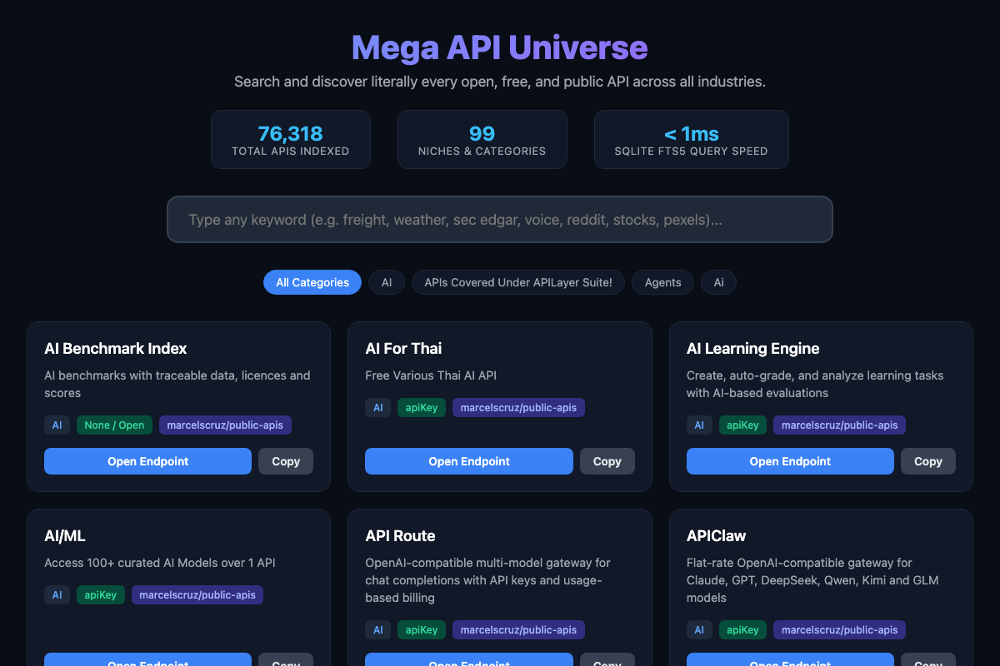

# 🌐 Mega API Universe: 76,000+ Free & Public APIs

> **The world's largest open directory of public, free, and freemium APIs** spanning 97 distinct domains—indexed into a single SQLite database with sub-millisecond Full-Text Search (FTS5), an interactive browser UI, and a Python CLI.



---

## ⚡ Quick Stats

- **Total Unique APIs**: `76,318`
- **Total Categories**: `97`
- **Full-Text Search Speed**: `< 1ms`
- **Formats**: SQLite (`FTS5`), JSON, CSV, Interactive HTML

---

## 🚀 Live Web Explorer

Browse the top 3,000 featured endpoints directly in your browser with live filtering, category pills, and 1-click endpoint copying:
👉 **[Open Live Explorer](https://oneclicksocials-debug.github.io/mega-api-universe/)** (or open `index.html` locally)

---

## 🔍 Instant Terminal Search

Query all 76,318 APIs instantly from your terminal:

```bash
# Search by any keyword
python3 search.py freight 5
python3 search.py "sec edgar" 5
python3 search.py weather 5
python3 search.py pexels 5
```

---

## 📦 Export to CSV on Demand

Export any niche or query to CSV in seconds:

```bash
# Export all freight APIs to CSV
python3 export_csv.py freight freight_apis.csv

# Export all Government APIs
python3 export_csv.py "Government" gov_apis.csv

# Export all 76,318 APIs
python3 export_csv.py ALL all_76k_apis.csv
```

---

## 🗄️ Database Downloads

You can download the full database directly:
- **SQLite Database (49 MB)**: [`mega_apis.sqlite.zip`](mega_apis.sqlite.zip) (Contains FTS5 virtual tables)
- **Master JSON Dataset (37 MB)**: [`mega_apis_master.json.zip`](mega_apis_master.json.zip)

---

## 📚 Category Catalogs

Browse pre-compiled markdown catalogs in [`categories/`](categories/):
- [AI & Machine Learning](categories/AI.md) (12,096 APIs)
- [Automation](categories/Automation.md) (12,812 APIs)
- [Developer Tools](categories/Developer_tools.md) (7,680 APIs)
- [Ecommerce](categories/Ecommerce.md) (9,676 APIs)
- [Jobs](categories/Jobs.md) (5,193 APIs)
- [Lead Generation](categories/Lead_generation.md) (4,541 APIs)
- [Social Media](categories/Social_media.md) (4,220 APIs)
- [Real Estate](categories/Real_estate.md) (2,382 APIs)
- [Logistics & Freight](categories/Logistics___Freight.md)
- [Government & Legal](categories/Government___Legal.md)

---

## 📄 License & Attribution

Compiled and deduplicated from:
- `APIs.guru OpenAPI Directory`
- `public-apis / public-apis`
- `marcelscruz / public-apis`
- `kawsarlog / Ultimate-API-List`
- Official US Federal Portals (SEC, DOT, BTS, FDA, Census)
